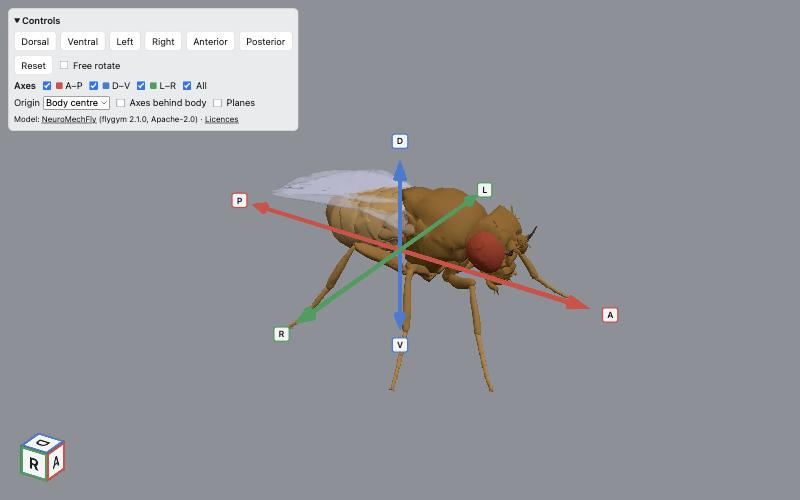
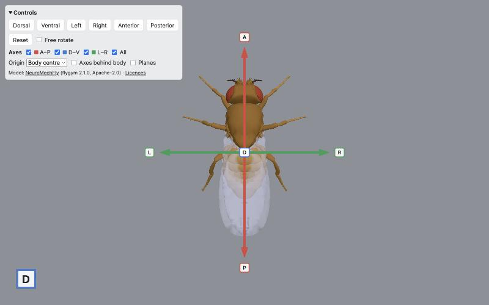
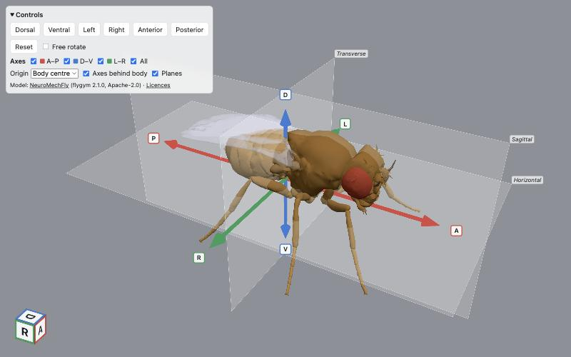
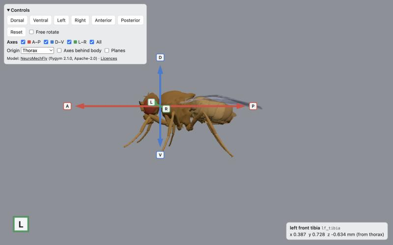

# Fly Viewer

An interactive 3D viewer of the adult fruit fly, *Drosophila melanogaster*, that runs in the browser. It shows the [NeuroMechFly](https://neuromechfly.org) body model in its neutral resting pose, with labelled anatomical axes, view presets and a readout of the body segment under the pointer.



| Dorsal view | Anatomical planes | Hover readout |
| --- | --- | --- |
|  |  |  |

## Features

- All 69 body segments of NeuroMechFly (flygym 2.1.0), posed by MuJoCo forward kinematics and baked into a single 0.6 MB glTF file.
- Orbit, zoom to cursor and pan, plus an optional free-rotate mode that can turn the fly upside down.
- Six view presets: dorsal, ventral, left, right, anterior and posterior.
- Anatomical axes (A–P, D–V, L–R) that can be toggled one by one, measured from the body centre or the thorax.
- Optional sagittal, horizontal and transverse planes.
- An orientation cube in the corner; click a face to jump to that view.
- A hover readout giving the segment name ("left front tibia") and the point's position in millimetres.
- The URL records the camera and all settings, so a copied link reopens the same view.

## Controls

| Input | Action |
| --- | --- |
| Left drag / one-finger drag | Rotate |
| Wheel / pinch | Zoom toward the cursor |
| Right drag, Shift + drag / two-finger drag | Pan |
| Double-click a part | Centre the view on that point |
| Hover a part (tap on touch screens) | Show its name and position |
| Click a face of the corner cube | Go to that view |
| `R` | Reset the view |
| `1` `2` `3` | Toggle the A–P, D–V and L–R axes |
| `A` | Toggle all axes |

## Coordinates

Everything is in the fly's own frame, in millimetres: right-handed, Z-up, with **+x anterior**, **+y the fly's left** and **+z dorsal**. The viewer rotates the whole fly once to fit three.js's Y-up convention. The axes, planes and readout are all expressed in fly coordinates, so they always match the body. Note that the fly's left appears on the viewer's right in ventral and anterior views.

The readout is measured from the chosen axis origin: either the centre of the bounding box, at (−0.553, 0, 0.826) mm, or the thorax (the model's root, at the neck–thorax junction), at (0.496, 0, 1.3) mm.

The URL hash keeps the camera position and orbit target in fly mm, for example `#cam=-0.564,0,12.093,-0.553,0,0.826&axes=ap,dv&origin=thorax&planes`.

## Development

You need Node 22 or newer.

```bash
npm ci
npm run dev       # http://localhost:5173
npm run build     # static site in dist/
npm run preview   # serve dist/ locally
```

The baked model (`public/fly.glb`, `public/fly.meta.json`) is committed, so you don't need Python to work on the viewer.

### Re-baking the model

You only need to re-bake when the flygym version changes. This needs Python 3.12–3.14:

```bash
python3.12 -m venv .venv
.venv/bin/pip install -r tools/requirements.txt   # exact pins: flygym 2.1.0, mujoco 3.9.0, ...
npm ci                                              # provides the pinned glTF-Transform CLI
.venv/bin/python -I tools/bake_fly.py
```

The bake builds the model with flygym, applies the neutral pose and runs MuJoCo's forward kinematics. It then writes one named mesh per segment in fly-frame millimetres and compresses the result with meshopt. It stops with an error if any segment is missing, if any mesh is inside-out, or if the file is over 1.5 MB. To look at flygym's source assets, `tools/fetch_flygym.sh` checks out the pinned commit into `vendor/flygym/`.

See [`docs/PLAN.md`](docs/PLAN.md) for the full design: assets, coordinate conventions, architecture and pitfalls.

## Deploying to GitHub Pages

`.github/workflows/pages.yml` builds the site and deploys it on every push to `main`. To enable it:

1. Push this repository to GitHub.
2. In **Settings → Pages**, set **Source** to **GitHub Actions**.

The build uses relative asset paths, so it works under the project-site path (`https://<user>.github.io/<repo>/`) with no changes.

## Credits and citation

The fly model, meshes and neutral pose come from **NeuroMechFly** via [flygym](https://github.com/NeLy-EPFL/flygym) 2.1.0 (commit `38c8ec6`). They are © The NeuroMechFly v2 Authors and licensed under Apache-2.0. If you use this viewer in your work, please cite both NeuroMechFly papers, as the flygym authors ask:

```bibtex
@article{LobatoRios2022,
  title   = {{NeuroMechFly}, a neuromechanical model of adult {Drosophila} melanogaster},
  author  = {Lobato-Rios, Victor and Ramalingasetty, Shravan Tata and {\"O}zdil, Pembe Gizem and Arreguit, Jonathan and Ijspeert, Auke Jan and Ramdya, Pavan},
  journal = {Nature Methods},
  volume  = {19},
  number  = {5},
  pages   = {620--627},
  year    = {2022},
  doi     = {10.1038/s41592-022-01466-7}
}

@article{WangChen2024,
  title   = {{NeuroMechFly} v2: simulating embodied sensorimotor control in adult {Drosophila}},
  author  = {Wang-Chen, Sibo and Stimpfling, Victor Alfred and Lam, Thomas Ka Chung and {\"O}zdil, Pembe Gizem and Genoud, Louise and Hurtak, Femke and Ramdya, Pavan},
  journal = {Nature Methods},
  volume  = {21},
  number  = {12},
  pages   = {2353--2362},
  year    = {2024},
  doi     = {10.1038/s41592-024-02497-y}
}
```

Rendering uses [three.js](https://threejs.org) (MIT), and the model is decoded with meshoptimizer (MIT).

## License

Apache-2.0; see [`LICENSE`](LICENSE). See [`NOTICE`](NOTICE) for attributions, and [`public/THIRD_PARTY_LICENSES.txt`](public/THIRD_PARTY_LICENSES.txt) for the licences of the bundled libraries.
